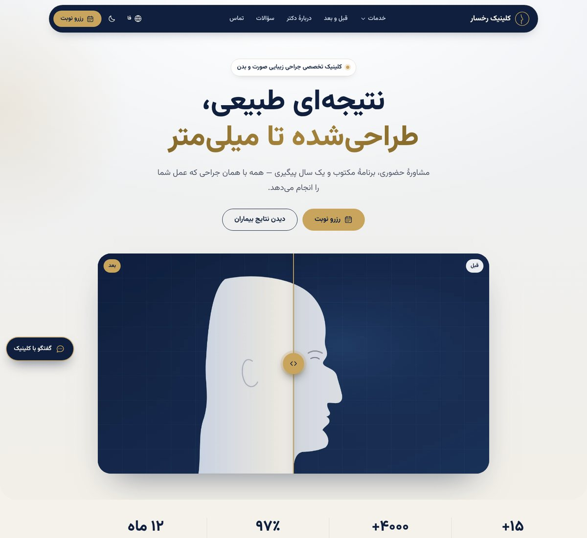
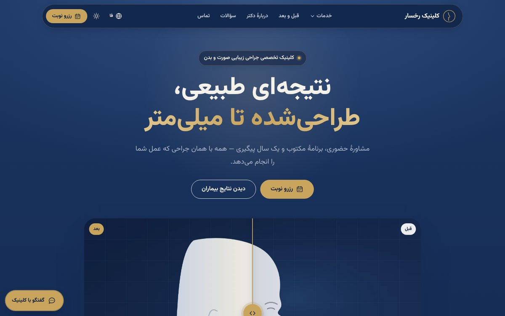
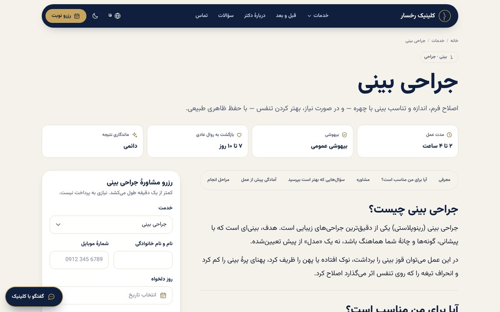
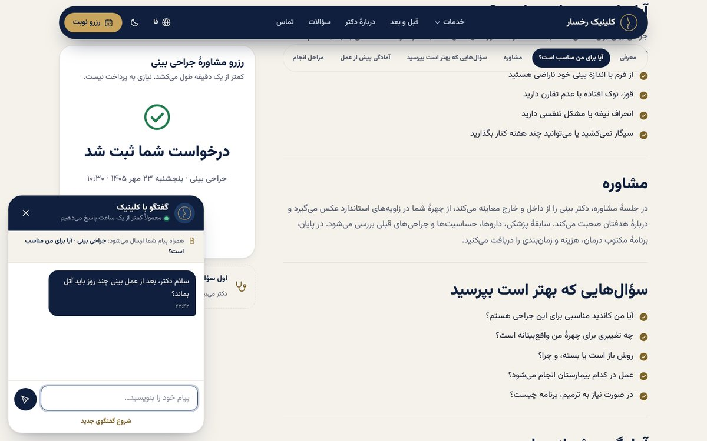
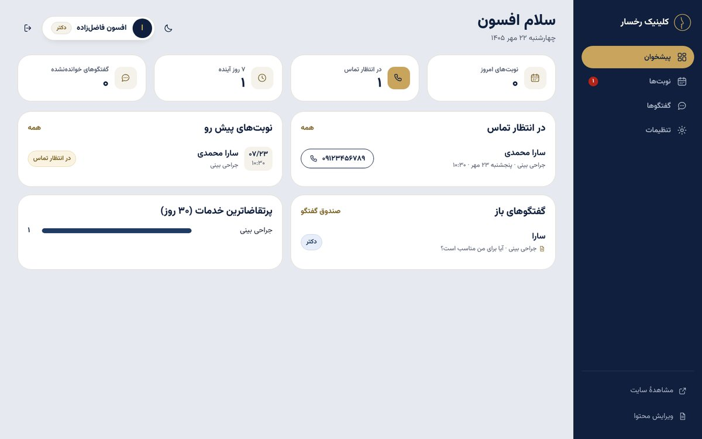
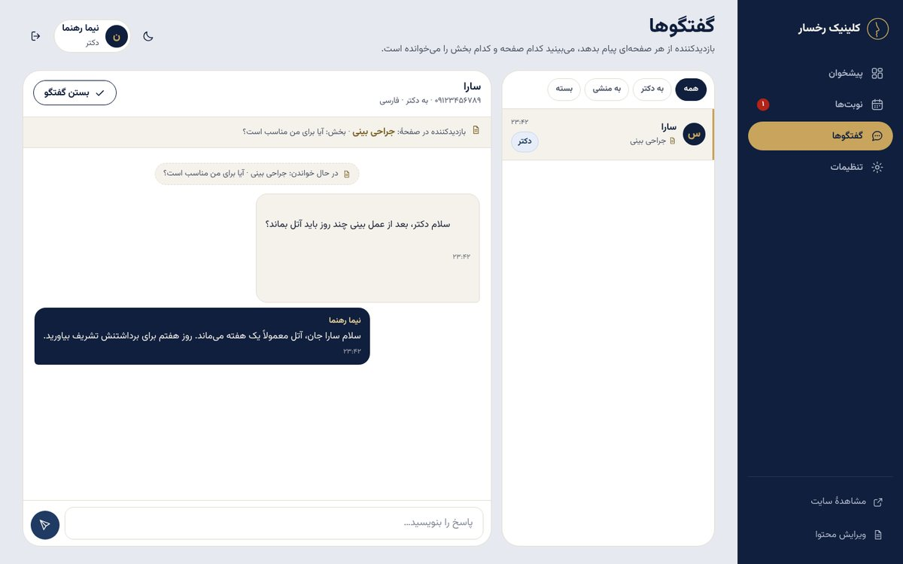
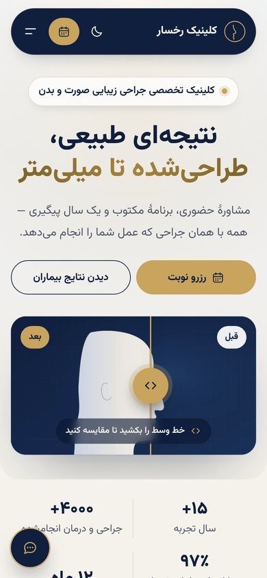
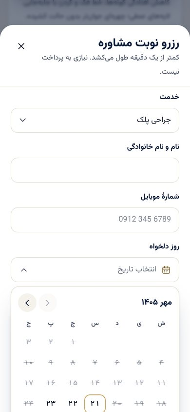

<div dir="rtl">

# وب‌اپ کلینیک جراحی زیبایی «رخسار» — Django

سایت سه‌زبانه (فارسی، عربی، انگلیسی) با حالت تاریک، اسلایدر قبل و بعد، فرم رزرو کنار هر خدمت، چت با دکتر یا منشی که صفحه و بخشِ در حال مطالعهٔ بیمار را هم می‌فرستد، پنل جداگانهٔ دکتر و منشی، و اطلاع‌رسانی به تلگرام، بله، ایتا، واتساپ، ایمیل و وب‌هوک.

## تصاویر

| صفحهٔ اصلی | حالت تاریک |
|---|---|
|  |  |

| صفحهٔ خدمت با فرم رزرو کناری | چت بیمار (صفحه و بخش همراه پیام می‌رود) |
|---|---|
|  |  |

| پنل — پیشخوان | پنل — گفتگو با بیمار |
|---|---|
|  |  |

| موبایل | رزرو با تقویم شمسی |
|---|---|
|  |  |

---

## ۱. اجرای سریع روی کامپیوتر خودتان

پیش‌نیاز فقط **Python نسخهٔ ۳.۱۰ یا بالاتر** است (در ویندوز موقع نصب تیک «Add python.exe to PATH» را بزنید). اینترنت فقط بار اول برای نصب پکیج‌ها لازم است.

| سیستم | کاری که می‌کنید |
|---|---|
| ویندوز | پوشهٔ پروژه را از zip خارج کنید و روی `run.bat` دو بار کلیک کنید |
| لینوکس / مک | در ترمینال داخل پوشهٔ پروژه: `bash run.sh` |

اسکریپت به ترتیب این کارها را انجام می‌دهد و مرحله‌ها را با شماره نشان می‌دهد:

1. ساخت محیط مجازی `.venv` (فقط بار اول)
2. نصب پکیج‌ها از `requirements.txt` (بار اول چند دقیقه طول می‌کشد)
3. ساخت `.env` از روی `.env.example` (اگر وجود نداشته باشد) و ساخت دیتابیس
4. بارگذاری محتوای نمونه و حساب‌ها — **فقط وقتی دیتابیس خالی است**؛ ویرایش‌های شما در اجراهای بعدی دست نمی‌خورد
5. روشن کردن سرور روی `http://127.0.0.1:8000` و باز کردن خودکار مرورگر

برای خاموش کردن سرور `Ctrl+C` را بزنید. برای اجرای دوباره همان فایل را دوباره اجرا کنید.
در لینوکس/مک پورت را می‌شود عوض کرد: `PORT=9000 bash run.sh`

اگر بعداً خواستید محتوای نمونه دوباره از نو بارگذاری شود (مثلاً بعد از گرفتن نسخهٔ جدید پروژه):

```bash
# ویندوز
.venv\Scripts\python manage.py seed_demo
# لینوکس / مک
.venv/bin/python manage.py seed_demo
```

## ۲. آدرس‌ها و حساب‌های نمونه

| بخش | آدرس |
|---|---|
| سایت فارسی / عربی / انگلیسی | `/fa/` · `/ar/` · `/en/` |
| پنل دکتر و منشی | `/panel/` |
| ویرایش محتوا (خدمات، عکس‌ها، سؤالات، نظرات) | `/admin/` |
| نقشهٔ سایت و robots | `/sitemap.xml` · `/robots.txt` |

| نقش | نام کاربری | رمز |
|---|---|---|
| مدیر کل | `admin` | `admin12345` |
| دکتر (پنل + تنظیمات + ویرایش محتوا) | `doctor` | `doctor12345` |
| منشی (فقط پنل نوبت و گفتگو) | `secretary` | `secretary12345` |

> پیش از انتشار، رمزها را عوض کنید: `python manage.py changepassword admin`

## ۳. چه چیزهایی ساخته شده

**سایت عمومی** — ترتیب لندینگ برای سئو و درگیر شدن تدریجی بیمار:
هیرو (با اسلایدر قبل/بعد و یک حرکت آرام هنگام لود) ← نشانه‌های اعتماد ← خدمات با فیلتر دسته ← نتایج قبل و بعد ← مسیر درمان ← معرفی دکتر ← نظرات بیماران ← سؤالات متداول ← فرم رزرو ← فوتر.

- **هدر جدا** با گوشه‌های ۵۰ پیکسلی، چسبان، هنگام اسکرول به پایین مخفی و با اسکرول به بالا ظاهر می‌شود.
- **اسلایدر قبل و بعد**: با موس، لمس انگشت و کلیدهای جهت کار می‌کند؛ خط مرز و دستهٔ واضح؛ در RTL و LTR درست جهت‌یابی می‌شود.
- **صفحهٔ هر خدمت** (الگو گرفته از ساختار انجمن جراحان پلاستیک آمریکا): معرفی، کاندیدها، مشاوره، سؤال‌ها، آمادگی، مراحل، نقاهت، خطرات، نتیجه، گالری، سؤالات — با **فرم رزرو چسبان کنار متن** و نوار رزرو پایین صفحه در موبایل.
- **فرم رزرو یک‌دقیقه‌ای**: انتخاب خدمت، نام، موبایل (اعداد فارسی هم قبول است)، **تقویم شمسی** برای فارسی و میلادی برای عربی/انگلیسی، ساعت‌های خالی به‌صورت زنده (ساعت پر شده غیرفعال است)، جمعه‌ها و روزهای گذشته بسته، کد پیگیری.
- **چت با دکتر یا منشی** در همهٔ صفحه‌ها: عنوان صفحه و بخشی که بیمار در حال خواندنش است همراه پیام می‌رود (و به خود بیمار هم نشان داده می‌شود).
- سه زبان با راست‌به‌چپ/چپ‌به‌راست کامل، حالت تاریک (با حفظ انتخاب کاربر)، فونت وزیرمتن، ریسپانسیو برای موبایل و تبلت.
- سئو: `hreflang`، `canonical`، Open Graph، داده‌های ساختاریافتهٔ MedicalClinic / MedicalProcedure / FAQPage / BreadcrumbList، نقشهٔ سایت چندزبانه.

**پنل دکتر و منشی** (`/panel/`):
- پیشخوان: نوبت‌های امروز، در انتظار تماس، ۷ روز آینده، گفتگوهای خوانده‌نشده، پرتقاضاترین خدمات.
- نوبت‌ها: جستجو، فیلتر وضعیت/تاریخ/خدمت، تغییر وضعیت در همان جدول، خروجی اکسل، صفحهٔ جزئیات با دکمهٔ تماس و واتساپ و سابقهٔ همان شماره.
- گفتگوها: صندوق دکتر/منشی، نمایش زندهٔ صفحه و بخشِ بیمار، پاسخ‌دهی لحظه‌ای.
- اعلان زنده: شمارندهٔ کنار منو و پیام «درخواست نوبت جدید» بدون رفرش.
- تنظیمات (فقط دکتر و مدیر): کانال‌های اطلاع‌رسانی، ساعت‌های نوبت‌دهی، ظرفیت هر ساعت، روزهای تعطیل.

## ۴. اتصال ربات تلگرام (و بقیهٔ پیام‌رسان‌ها)

در پنل: **تنظیمات ← افزودن کانال**.

1. در تلگرام به `@BotFather` پیام `/newbot` بدهید و توکن را کپی کنید.
2. یک گروه خصوصی برای دکتر و منشی بسازید و ربات را عضو کنید.
3. در پنل کانالی با نوع «ربات تلگرام» بسازید، توکن را وارد و ذخیره کنید.
4. دکمهٔ «اتصال ربات» را بزنید، بعد در گروه `/id` بفرستید. عددی را که ربات جواب می‌دهد در «گیرنده» بگذارید و ذخیره کنید.
5. «ارسال پیام آزمایشی» را بزنید.

از این به بعد:
- هر نوبت جدید با دکمه‌های **✓ تأیید** و **✕ لغو** در گروه می‌آید؛ زدن دکمه وضعیت نوبت را در پنل هم عوض می‌کند.
- هر پیام چت با برچسب `#C12` می‌آید؛ کافی است روی آن **Reply** بزنید تا جوابتان در چت سایت برای بیمار نمایش داده شود.

> **مهم برای سرورهای داخل ایران:** دسترسی سرور به `api.telegram.org` مسدود است. یکی از این راه‌ها:
> - سرور خارج از ایران، یا
> - در فیلد «پراکسی HTTP» آدرس پراکسی، یا در «آدرس API» یک واسط (Relay) وارد کنید، یا
> - از **ربات بله** استفاده کنید (همان مراحل، از `@botfather` در بله؛ داخل ایران کار می‌کند و دکمه‌ها و Reply را هم پشتیبانی می‌کند).

سایر کانال‌ها: **ایتا** (توکن ایتایار + شناسهٔ کانال)، **واتساپ Cloud API** (Access Token + Phone number ID + شمارهٔ گیرنده)، **ایمیل**، و **وب‌هوک** برای n8n / Make / Zapier که از آن‌جا به اینستاگرام، اسلک یا هر سرویس دیگری بفرستید. می‌توانید برای هر کانال انتخاب کنید کدام رویدادها ارسال شود.

ربات از خط فرمان هم قابل مدیریت است:

```bash
python manage.py bot_webhook              # فهرست ربات‌ها
python manage.py bot_webhook 1 set        # ثبت وب‌هوک (SITE_BASE_URL باید https باشد)
python manage.py bot_webhook 1 info
```

## ۵. جایگزین کردن محتوای نمونه (پیش از انتشار)

همه‌چیز از `/admin/` قابل ویرایش است و هر فیلد سه نسخهٔ فارسی/عربی/انگلیسی دارد (فارسی اجباری است، بقیه اگر خالی بمانند فارسی نمایش داده می‌شود).

- **تنظیمات سایت:** نام کلینیک، نام و عکس دکتر، شمارهٔ نظام پزشکی، تلفن، نشانی، شبکه‌های اجتماعی، آمار هیرو.
- **نمونه‌های قبل و بعد:** دو عکس هم‌اندازه با نسبت ۱۶:۹ (مثلاً ۱۶۰۰×۹۰۰)، صورت دقیقاً هم‌تراز. فقط با رضایت‌نامهٔ کتبی بیمار؛ تیک «رضایت‌نامهٔ کتبی بیمار موجود است» را بزنید. گزینهٔ «نمایش در بالای صفحهٔ اصلی» عکس هیرو را تعیین می‌کند.
- **نظرات بیماران:** نظرات نمونه را با نظرات واقعی جایگزین کنید.
- وقتی محتوای واقعی کامل شد، در `.env` مقدار `DEMO_CONTENT=0` را بگذارید تا یادداشت «نسخهٔ نمایشی» از فوتر حذف شود.

> تصاویر قبل و بعد فعلی **تصویرسازی نمونه** هستند، نه عکس بیمار؛ متن‌های پزشکی هم آموزشی و عمومی‌اند و بهتر است دکتر آن‌ها را بازبینی کند.

## ۶. ترجمه‌ها

متن‌های رابط کاربری در `locale/translations.py` هستند. پس از افزودن یا تغییر متن در قالب‌ها:

```bash
python manage.py makemessages -l fa -l ar --ignore=staticfiles --ignore=media --ignore=locale --ignore=tests
python locale/build_locale.py     # .po ها را پر و .mo ها را می‌سازد؛ متن‌های بی‌ترجمه را گزارش می‌دهد
```

نیازی به نصب gettext نیست.

## ۷. انتشار روی سرور لینوکس (Production)

همهٔ فایل‌های لازم در پوشهٔ `deploy/` هستند. مسیر نمونه `/srv/rokhsar` و دامنهٔ نمونه `example.ir` است؛ این دو را با مقدار خودتان عوض کنید.

```bash
# ۱) پیش‌نیازها (اوبونتو / دبیان)
sudo apt update && sudo apt install -y python3 python3-venv nginx certbot python3-certbot-nginx

# ۲) پروژه را در /srv/rokhsar قرار دهید، سپس اجرای اول (کلید امن و .env را خودش می‌سازد و حساب مدیر را می‌پرسد)
cd /srv/rokhsar
bash deploy/production.sh example.ir
#    وقتی «Starting gunicorn» را دیدید، با Ctrl+C متوقفش کنید؛ از این به بعد systemd اجرایش می‌کند.

# ۳) دسترسی فایل‌ها برای کاربر سرویس
sudo chown -R www-data:www-data /srv/rokhsar

# ۴) سرویس همیشه‌روشن
sudo cp deploy/rokhsar.service /etc/systemd/system/
sudo systemctl daemon-reload && sudo systemctl enable --now rokhsar

# ۵) nginx و گواهی https
sudo cp deploy/nginx.conf /etc/nginx/sites-available/rokhsar      # اول داخلش example.ir را عوض کنید
sudo ln -s /etc/nginx/sites-available/rokhsar /etc/nginx/sites-enabled/
sudo nginx -t && sudo systemctl reload nginx
sudo certbot --nginx -d example.ir -d www.example.ir

# ۶) بعد از فعال شدن https، در فایل .env مقدار SECURE_COOKIES=1 بگذارید و:
sudo systemctl restart rokhsar
```

- اسکریپت `production.sh` حالت DEBUG را خاموش می‌کند، کلید امن تصادفی می‌سازد، فایل‌های استاتیک را جمع می‌کند و حساب‌های نمونه (`doctor12345` و…) را **نمی‌سازد**. حساب دکتر و منشی را از `/admin/` بسازید و در گروه‌های `doctor` و `secretary` بگذارید.
- برای به‌روزرسانی پروژه: فایل‌های جدید را جایگزین کنید، `bash deploy/production.sh` را یک بار اجرا و متوقف کنید، سپس `sudo systemctl restart rokhsar`.
- برای پایگاه دادهٔ PostgreSQL متغیرهای `DB_*` را در `.env` پر کنید و `pip install "psycopg[binary]"` را داخل `.venv` اجرا کنید.

## ۸. تست‌ها

```bash
python manage.py test tests
```

۱۰ تست: تبدیل تاریخ شمسی، رندر هر سه زبان، سئو، ثبت نوبت و ارسال به تلگرام، ظرفیت ساعت و اعتبارسنجی، چت با اطلاعات صفحه و پاسخ از پنل، Reply و دکمهٔ تأیید در تلگرام، سطح دسترسی پنل، تغییر وضعیت و خروجی اکسل.

## ۹. ساختار پروژه

```
config/                 تنظیمات و آدرس‌ها
apps/core/              صفحهٔ اصلی، تنظیمات سایت، نظرات، تاریخ شمسی، سئو، seed_demo
apps/procedures/        دسته‌ها، خدمات، بخش‌های هر خدمت، سؤالات، نمونه‌های قبل/بعد
apps/bookings/          فرم و API رزرو، ساعت‌های خالی
apps/chat/              API چت بازدیدکننده
apps/panel/             پنل دکتر و منشی
apps/notifications/     تلگرام، بله، ایتا، واتساپ، ایمیل، وب‌هوک + وب‌هوک ورودی ربات
templates/              قالب‌ها (partials: هدر، فوتر، فرم رزرو، اسلایدر، چت)
static/css/site.css     طراحی سایت (توکن‌های رنگ طبق راهنمای سرمه‌ای و طلایی)
static/css/panel.css    طراحی پنل
static/js/site.js       اسلایدر، تقویم شمسی، فرم رزرو، چت، منوها، حالت تاریک
static/js/panel.js      اعلان زنده، چت پنل، تغییر وضعیت
locale/                 ترجمه‌های فارسی و عربی
tests/                  تست‌ها
```

## ۱۰. رنگ‌ها (طبق راهنمای رنگ)

۶۰٪ زمینهٔ روشن (عاج `#F5F2EC`، خاکستری روشن `#E6E9EF`، سفید) · ۳۰٪ سرمه‌ای `#0F1F3D` · ۱۰٪ طلایی `#C8A45D`.
بخش‌های تیره فقط هدر/هیرو، رزرو و فوتر هستند؛ طلایی روی زمینهٔ روشن هرگز متن نیست (به‌جایش `#7C6226`)؛ «رزرو نوبت» تنها دکمهٔ طلایی است.

</div>
